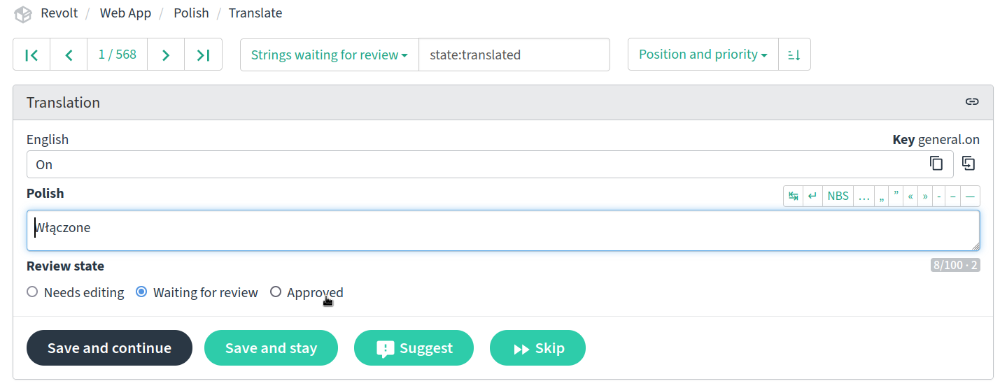

<h1>
  Revolt Translations
  
  
  
  
  
  
  
   
  
  
  
  
</h1>
The repo managing translations at Revolt.

 

This repository contains translation files and acts as a way to handle and manage requests. You can help translate Revolt to new languages and improve existing translations on [Revolt's Weblate](https://translate.revolt.chat).

> [!IMPORTANT]  
> **Don't** submit fixes or new translations via pull requests. Please only open a pull request if adding new strings to the source language (en_GB) or modifying the scripts contained within this repository.

## Languages

The following table shows a list of languages, their contributors, and maintainers (people enlisted to verify that the language's translations are up to standard).

Please note that this table **only includes languages that are currently available in the app**. If a language has been translated via Weblate and you want it to be added to the app, [please click here](https://github.com/revoltchat/frontend/issues/135).

|   | Language | Maintainers | Contributors |
|:-:|---|---|---|
|🇬🇧|English (Traditional) / en|[@insertish](https://github.com/insertish)||
|🇺🇸|English (Simplified) / en_US|||
|🇸🇦|عربي / ar|[@LedaThemis](https://github.com/LedaThemis)|[@vloddot](https://github.com/vloddot) [@AbdoDev](https://github.com/AbdoDev) [@DaRandomCube](https://github.com/DaRandomCube)|
|🇮🇳|অসমীয়া / as|||
|🇦🇿|Azərbaycan dili / az|||
|🇧🇾|Беларуская / be|[@1enify](https://github.com/1enify)||
|🇧🇬|Български / bg|||
|🇧🇩|বাংলা / bn|[@Cynycal2003](https://github.com/Cynycal2003)||
|br|Brezhoneg / br|[@SperedAnveliour](https://github.com/SperedAnveliour)||
|🇪🇸|Català / ca|[@khleyhub](https://github.com/khleyhub)|[@TallerThanShort](https://github.com/TallerThanShort)|
|🇵🇭|Bisaya / ceb|[@zee-html](https://github.com/zee-html)||
|krd|کوردی / ckb|[@fanticwastaken](https://github.com/fanticwastaken)|[@NoLogicAlan](https://github.com/NoLogicAlan)|
|🇨🇿|Čeština / cs|[@Fjuro](https://github.com/Fjuro)|[@Cikarin3](https://github.com/Cikarin3)|
|🇩🇰|Dansk / da|[@krestenlaust](https://github.com/krestenlaust)||
|🇩🇪|Deutsch / de|[@sussycatgirl](https://github.com/sussycatgirl)|[@nitrobw](https://github.com/nitrobw) [@arktn](https://github.com/arktn) [@infi](https://github.com/infi) [@GoodestGoyim](https://github.com/GoodestGoyim)|
|🇬🇷|Ελληνικά / el|[@SudoJanast](https://github.com/SudoJanast)||
|🇪🇸|Español / es|[@z3ro0k](https://github.com/z3ro0k) [@fernandopal](https://github.com/fernandopal) [@gatomod](https://github.com/gatomod)|[@Dorovich](https://github.com/Dorovich) [@DevArxify](https://github.com/DevArxify) [@undefined](https://github.com/undefined) [@Mathesito](https://github.com/Mathesito)|
|🇪🇸|Español (América Latina) / es_419|[@7Macros](https://github.com/7Macros) [@gatomod](https://github.com/gatomod)|[@undefined](https://github.com/undefined) [@exelenuwu](https://github.com/exelenuwu)|
|🇪🇪|eesti / et|[@Kentledge](https://github.com/Kentledge)|[@u032](https://github.com/u032) [@Lefromrevolt](https://github.com/Lefromrevolt)|
|🇫🇮|suomi / fi|[@blarpdog](https://github.com/blarpdog)||
|🇵🇭|Filipino / fil|[@I2rys](https://github.com/I2rys)|[@searinminecraft](https://github.com/searinminecraft) [@zee-html](https://github.com/zee-html)|
|🇫🇷|Français / fr|[@Hades785](https://github.com/Hades785) [@Kasahe](https://github.com/Kasahe) [@Achlys12](https://github.com/Achlys12) [@TapwaveZodiac](https://github.com/TapwaveZodiac)|[@RedNight-was-taken](https://github.com/RedNight-was-taken) [@Gaby5873](https://github.com/Gaby5873) [@ay700r](https://github.com/ay700r) [@Unknown-user-dev](https://github.com/Unknown-user-dev)|
|🇮🇪|Gaeilge / ga|||
|🇮🇳|हिन्दी / hi|[@Infiniticity](https://github.com/Infiniticity)|[@CodeWhiteWeb](https://github.com/CodeWhiteWeb) [@FakeFerg](https://github.com/FakeFerg) [@Yeikzy](https://github.com/Yeikzy)|
|🇭🇷|Hrvatski / hr|||
|🇭🇺|Magyar / hu|[@f3rr31](https://github.com/f3rr31)||
|🇦🇲|հայերեն / hy|||
|🇮🇩|Bahasa Indonesia / id|[@liimee](https://github.com/liimee)|[@ilhamfauzan](https://github.com/ilhamfauzan) [@DaGamerFiles](https://github.com/DaGamerFiles)|
|🇮🇸|Íslenska / is|||
|🇮🇹|Italiano / it|[@plumcakey](https://github.com/plumcakey)|[@Gabriele73](https://github.com/Gabriele73) [@SpheLC](https://github.com/SpheLC) [@Pantanino](https://github.com/Pantanino)|
|🇯🇵|日本語 / ja|[@chelley](https://github.com/chelley)|[@Joshument](https://github.com/Joshument)|
|🇰🇷|한국어 / ko|||
|🇱🇺|Lëtzebuergesch / lb|||
|🇱🇹|Lietuvių / lt|[@ErnestasKaralius](https://github.com/ErnestasKaralius)||
|🇱🇻|Latviešu / lv|[@rMazeiks](https://github.com/rMazeiks)|[@GGLVXD](https://github.com/GGLVXD)|
|🇲🇰|Македонски / mk|||
|🇲🇾|Bahasa Melayu / ms|[@isPxyhl](https://github.com/isPxyhl)||
|🇳🇴|Norsk bokmål / nb_NO|[@tobggs](https://github.com/tobggs)||
|🇳🇱|Nederlands / nl|[@sympact06](https://github.com/sympact06)||
|🇮🇷|فارسی / fa|[@DevEvil99](https://github.com/DevEvil99) [@shareghzadeh](https://github.com/shareghzadeh)||
|🇵🇱|Polski / pl|[@Pawelek-dev](https://github.com/Pawelek-dev) [@HosachiPL](https://github.com/HosachiPL)|[@CyberL1](https://github.com/CyberL1)|
|🇧🇷|Português (do Brasil) / pt_BR|[@yanndere](https://github.com/yanndere)|[@Hokiper](https://github.com/Hokiper) [@YoshiroOno](https://github.com/YoshiroOno) [@carmoswitch](https://github.com/carmoswitch) [@kibsbs](https://github.com/kibsbs) [@CachorroninjaBot](https://github.com/CachorroninjaBot) [@itsyounotme](https://github.com/itsyounotme)|
|🇵🇹|Português (Portugal) / pt_PT|[@Tmpod](https://github.com/Tmpod)|[@SlicedBlueApple](https://github.com/SlicedBlueApple) [@undefined](https://github.com/undefined)|
|🇷🇴|Română / ro|[@Edward205](https://github.com/Edward205)|[@S703T](https://github.com/S703T)|
|🇷🇺|Русский / ru|[@div2005](https://github.com/div2005)|[@zptr1](https://github.com/zptr1) [@arslee07](https://github.com/arslee07) [@saikodemuchi](https://github.com/saikodemuchi)|
|🇸🇰|Slovensky / sk|[@ShadowLp174](https://github.com/ShadowLp174)||
|🇸🇮|Slovenščina / sl|||
|🇦🇱|Shqip / sq|||
|🇷🇸|Српски / sr|||
|🇱🇰|සිංහල / si||[@11257896](https://github.com/11257896)|
|🇸🇪|Svenska / sv|[@raggebatman](https://github.com/raggebatman)||
|🇮🇳|தமிழ் / ta|||
|🇹🇭|ไทย / th|[@xhayper](https://github.com/xhayper)||
|🇹🇷|Türkçe / tr|[@KerizAlperwastaken](https://github.com/KerizAlperwastaken) [@ramazaneris](https://github.com/ramazaneris)|[@vesley1](https://github.com/vesley1) [@omerasaf01](https://github.com/omerasaf01)|
|🇵🇰|اردو / ur|||
|🇺🇦|Українська / uk|[@div2005](https://github.com/div2005)|[@zptr1](https://github.com/zptr1) [@saikodemuchi](https://github.com/saikodemuchi)|
|vec|Vèneto / vec|||
|🇻🇳|Tiếng Việt / vi|[@barnacl437](https://github.com/barnacl437)||
|🇨🇳|简体中文 / zh_Hans|[@deluxghost](https://github.com/deluxghost)|[@YouTubeGameNana](https://github.com/YouTubeGameNana)|
|🇹🇼|繁體中文 / zh_Hant|[@Zhuzi-ouo](https://github.com/Zhuzi-ouo)||
|🙂|Toki Pona / tokipona|[@Gapva](https://github.com/Gapva)||
|EO|Esperanto / esperanto|[@Fussmatte](https://github.com/Fussmatte)||
|😸|OwO / owo|[@sussycatgirl](https://github.com/sussycatgirl) [@FanMclaine](https://github.com/FanMclaine)||
|🏴‍☠️|Pirate / pr|||
|🥺|Bottom / bottom|||
|💾|1337 / leet|||
|🪄|Enchantment Table / enchantment|||
|🐖|Pig Latin / piglatin|||

If you would like to maintain a language, please [open an issue](https://github.com/revoltchat/translations/issues/new/choose) with your request.

## What is a Maintainer?

Maintainers gain access to the Reviewer role on Weblate. This permits them to approve new strings, edit approved strings, and accept new suggestions. They may also be mentioned in GitHub issues to approve badges for others.

If you're a maintainer and no longer wish to be one, please [open an issue](https://github.com/revoltchat/translations/issues/new). Note that you will remain on the contributions list.

## Repo-level Maintenance

When adding badges to people, it must be done by editing the `contributors.json` file!
